# Bus Stop Tracking with RFID and LoRa

**A self-powered network of bus stops that tells passengers where their bus is, without mobile networks, without a server and without mains power.**

Each stop recognizes a bus that passes it by **RFID**, and passes that information to the other stops of the line by **LoRa radio**, stop to stop. Every stop has a row of LEDs, one per stop of the line, and the lit LED shows the **last stop the bus went through**. Each stop runs on **two Li-ion cells charged by a small solar panel**.

I designed both the **hardware** (a 4-layer PCB with solar charging, battery protection and power conversion) and the **firmware** (a PIC microcontroller running the RFID reader, the LoRa link, its own communication protocol with acknowledgements and retransmission, and on-site configuration). The system was built and tested as a **working proof of concept** on four stops.

<p align="center">
  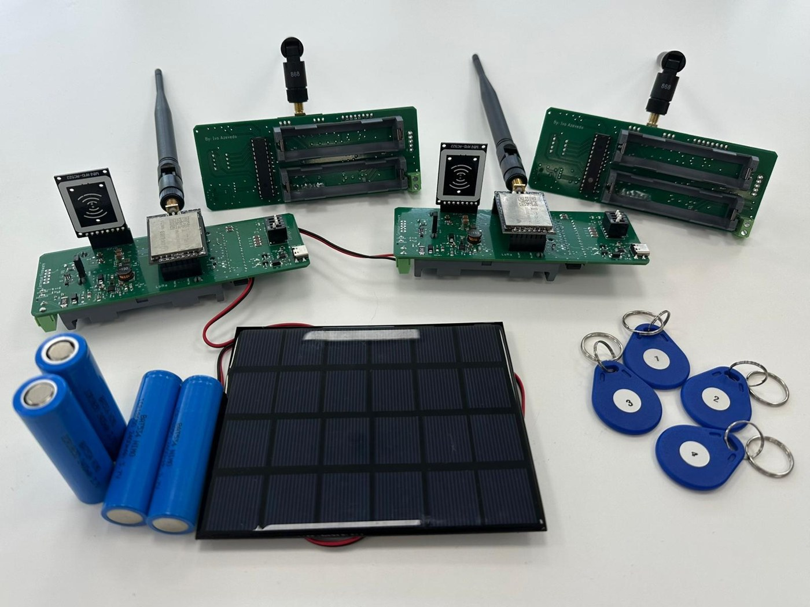<br>
  <em>The test setup: the stop boards (PCB with LoRa module, RFID reader and MCU), the 18650 cells, the solar panel and the RFID tags that stand in for the buses</em>
</p>

<p align="center">
  
  
  
  
  
  
  
</p>

---

## Contents

- [The problem](#the-problem)
- [The solution](#the-solution)
- [Repository structure](#repository-structure)
- [How it works](#how-it-works)
  - [Inside one stop](#inside-one-stop)
  - [Detecting the bus with RFID](#detecting-the-bus-with-rfid)
  - [Spreading the information along the line](#spreading-the-information-along-the-line)
  - [Frame format](#frame-format)
  - [Reliable delivery: ACK and retransmission](#reliable-delivery-ack-and-retransmission)
  - [Firmware state machine](#firmware-state-machine)
  - [Configuration on site](#configuration-on-site)
- [Hardware](#hardware)
  - [Power system](#power-system)
  - [Other subsystems](#other-subsystems)
  - [PCB design](#pcb-design)
- [Results](#results)
- [Known limitations and next steps](#known-limitations-and-next-steps)
- [Tools](#tools)
- [Author](#author)

---

## The problem

In many small towns, the bus stops have no real-time information at all. Passengers only have a printed timetable, so they wait without knowing where the bus is or whether it is late, which is especially frustrating in bad weather.

The usual solutions are expensive to run for a small network:

| | Usual approach | Drawback |
|---|---|---|
| **Detection** | GPS tracker in every bus | Active device per bus, more cost |
| **Communication** | Mobile network (GSM/4G) | Monthly subscriptions, higher consumption |
| **Processing** | Cloud server | Permanent internet, recurring costs |
| **Power** | Mains connection or disposable batteries | Civil works, or frequent battery changes |

---

## The solution

<p align="center">
  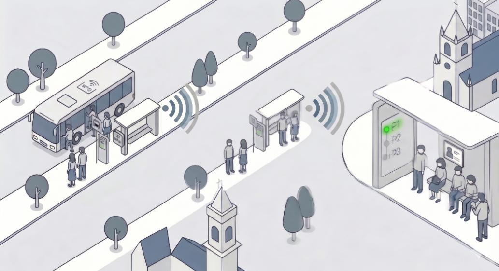<br>
  <em>The concept: the bus is detected at a stop, and the information travels by radio from stop to stop until it reaches every stop of the line</em>
</p>

Each choice replaces one of the drawbacks above:

- **RFID for detection:** a cheap, passive tag on the bus, read exactly when the bus is at the stop. No GPS and nothing powered on the bus.
- **LoRa for communication:** a private radio link on the licence-free 868 MHz band, long range and low power, with **no subscriptions**.
- **Decentralized processing:** every stop is an **autonomous node** running the same firmware. There is no central server: each stop talks only to its two neighbours, and the information hops along the line.
- **Solar power:** two rechargeable Li-ion cells and a small solar panel, so no mains connection is needed.

**Requirements** set for the system:

| Functional | Non-functional |
|---|---|
| Identify the bus at the stop automatically | Low power consumption |
| Accept only the buses authorized for that line | Low cost |
| Record the last stop of each bus | Autonomous power (no mains) |
| Send the information to the neighbouring stops | Simple installation |
| Forward it in the right direction along the line | Robust communication between stops |
| Guarantee reliable delivery between stops | Room for future evolution |
| Show passengers the last known position | |
| Configure the system on site | |

---

## Repository structure

```
.
├── LoRa_and_RFID_with_ACK.X/       # firmware: MPLAB X project for the PIC18F27K42
│   ├── main.c                      # application: state machine, LoRa protocol, ACK, config modes
│   ├── rc522.c / rc522.h           # RC522 RFID reader driver (SPI, MIFARE commands)
│   ├── mcc_generated_files/        # peripheral drivers generated by MCC (UART, SPI, TMR0, NVM, pins)
│   └── nbproject/, Makefile        # MPLAB X project files
├── PCB/                            # hardware: Autodesk Eagle project
│   ├── Esquematico.sch             # schematic
│   ├── Esquematico.brd             # 4-layer board layout
│   ├── Librarias_EAGLE/            # component libraries used in the design
│   └── Ficheiros_JLCPCB/           # fabrication outputs: Gerbers, BOM and pick-and-place
├── images/                         # figures used in this README
└── README.md
```

---

## How it works

### Inside one stop

Every stop is the same board running the same firmware. The only difference between stops is the **stop ID** (equal to its LoRa address) and the **list of authorized buses**, both stored in the PIC's internal EEPROM.

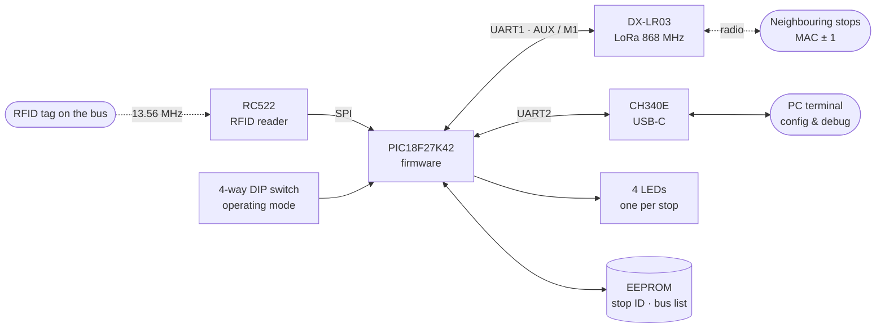

| Block | Part | Role |
|---|---|---|
| Microcontroller | **PIC18F27K42** (64 MHz, 128 KB Flash, 2 UARTs) | Runs the whole firmware |
| Radio | **DX-LR03-900T30D** LoRa module | Stop-to-stop link, fixed-point addressing, configured with AT commands |
| Bus detection | **RC522** reader + **MIFARE Classic 1K** tags | Reads the bus ID when the bus is at the stop |
| PC interface | **CH340E** USB-to-UART over **USB-C** | Configuration and debug from a serial terminal |
| User interface | 4 LEDs | The lit LED shows the last stop of the bus |

### Detecting the bus with RFID

Each bus carries a **MIFARE Classic 1K** tag holding its **bus ID** (1 byte, 0–255), written in **block 4**, the first block of sector 1. Sector 0 is avoided because it holds the manufacturer data.

In the main loop, the stop keeps polling for a tag:

1. Wake the RC522 from its soft power-down.
2. **Request**: is there a tag in the field? If not, power down again and go back to idle.
3. **Anticollision → Select → Authenticate** (key A) **→ Read** block 4 **→ Halt**.
4. Power the RC522 down again, to save energy between polls.
5. Check the bus ID against the **list of authorized buses** in EEPROM. A tag that isn't on the list (another line's bus, or a stray card) is ignored.

The reader's driver was adapted to the MPLAB XC8 compiler and is organized in layers: raw SPI access, then register read/write/bit operations, then the MIFARE commands that the application calls.

### Spreading the information along the line

The stops form a **linear, bidirectional chain**. Each stop knows its own ID, and its neighbours are simply **ID − 1** (behind) and **ID + 1** (in front). The LoRa modules work in **fixed-point mode**, so each frame is addressed to one specific module, and only that module delivers it to its microcontroller.

<p align="center">
  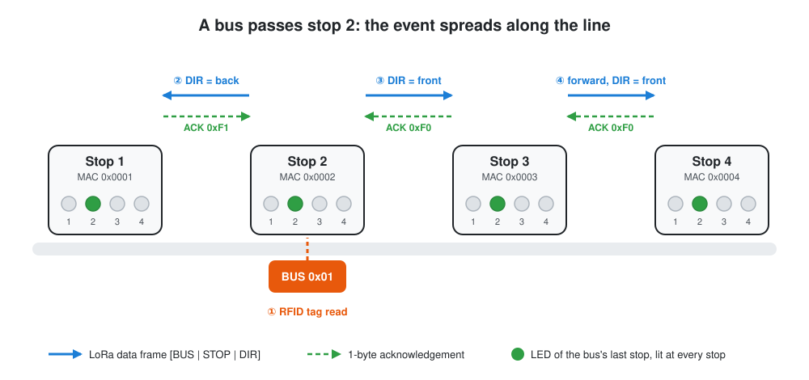
</p>

The forwarding rules are simple, and the same on every stop:

- **The bus is read by RFID** at this stop: send the event **backwards** (DIR = back), then **forwards** (DIR = front). The first stop of the line has no neighbour behind, so it only sends forwards.
- **A frame arrives by LoRa**: forward it to the next stop **in the same direction** it was travelling (the `DIR` field).
- **Duplicates are dropped:** each stop keeps, in RAM, a table with the **last known stop of every bus**. If a frame (or a tag read) reports the stop that is already recorded, nothing is sent. This stops the information from bouncing back and forth and avoids repeated transmissions when a bus waits at a stop.
- **Invalid frames are dropped:** unknown direction, stop ID 0, or a bus that isn't authorized.

Whenever the table changes, the stop **refreshes its LEDs**, so every stop on the line ends up showing the same position.

### Frame format

<p align="center">
  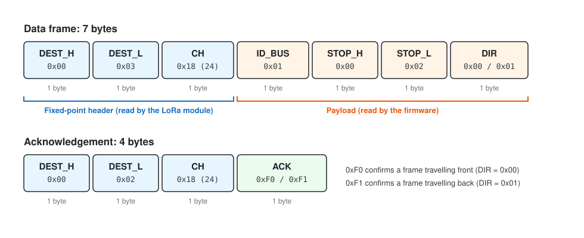
</p>

- The first 3 bytes are required by the LoRa module in fixed-point mode: the **destination address** and the **channel** (24, which is 868 MHz, on every stop). The module removes them, so the receiving microcontroller only gets the **4-byte payload**.
- **ID_BUS:** the bus, as read from the tag.
- **STOP_H / STOP_L:** the ID of the stop where the bus was **detected**. It travels unchanged, so every stop learns where the bus actually is, not which neighbour told it.
- **DIR:** `0x00` to keep going front, `0x01` to keep going back.

The acknowledgement is a single byte: `0xF0` confirms a frame travelling front and `0xF1` one travelling back. They were chosen to match the `DIR` values, which makes them easy to read in the debug output.

### Reliable delivery: ACK and retransmission

Radio frames can be lost, so every data frame has to be **acknowledged by the stop that receives it**. If the acknowledgement doesn't arrive, the frame is sent again.

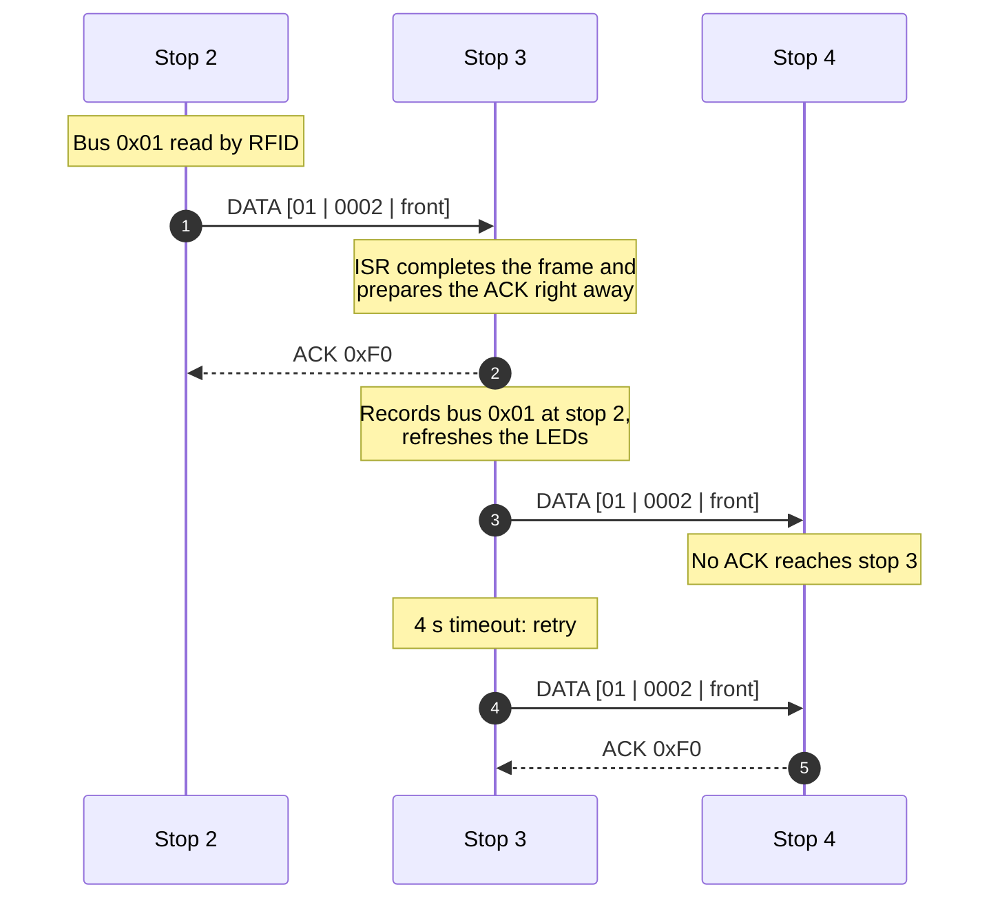

How it is implemented:

- **On the receiver**, the UART interrupt collects the 4 payload bytes. As soon as the frame is complete, the interrupt **prepares the ACK** (destination MAC ± 1, depending on the direction), and the main loop **sends it before processing the frame**, so the sender gets its answer as fast as possible.
- **On the sender**, after each frame the firmware waits up to **4 seconds** for the expected ACK byte. If none arrives it **retransmits, up to 5 attempts**. If the event came from RFID, the second direction is still tried even when the first one failed.
- **No deadlock while waiting:** while a stop waits for its own ACK, it keeps **answering the ACKs owed to other stops**, so two neighbours transmitting at the same time don't block each other.
- **Partial frames are discarded:** a timer (TMR0) restarts at every received byte. If the bytes stop arriving before the frame is complete, the timer expires and the buffer is cleared, so a fragment can't corrupt the next frame.
- **Radio settings:** the LoRa module's **CRC is enabled**, so corrupted frames are rejected by the radio, and the **transmit power was tuned** for the test distances. Before sending, the firmware waits for the module's **AUX** pin to show that it is idle.

What it looks like on the debug terminal:

<table>
  <tr>
    <td align="center" width="50%">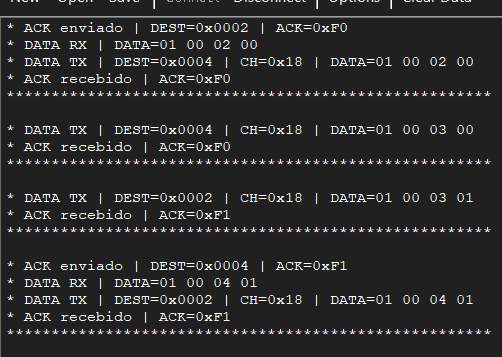</td>
    <td align="center" width="50%">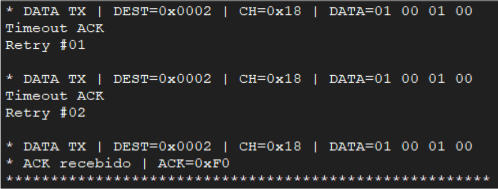</td>
  </tr>
  <tr>
    <td align="center"><em>Stop 3: forwarding frames and exchanging ACKs in both directions</em></td>
    <td align="center"><em>No ACK: the frame is retransmitted until the ACK arrives</em></td>
  </tr>
</table>

### Firmware state machine

The application is a **state machine** in `main.c`. Received LoRa frames and pending ACKs always have priority over reading the RFID reader or entering a configuration mode.

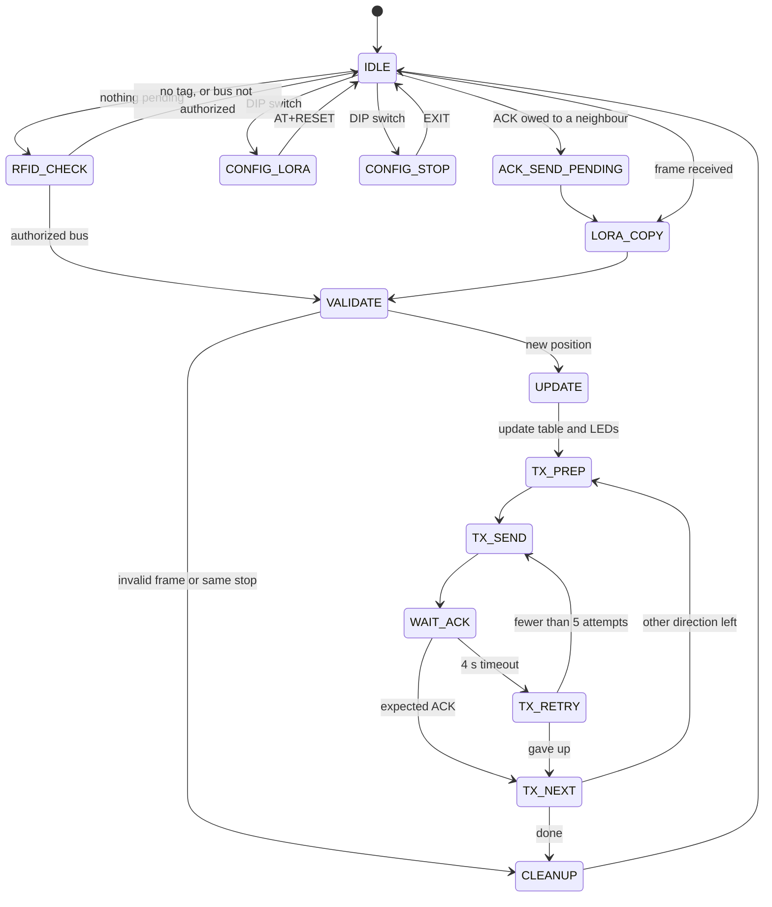

| State | What it does |
|---|---|
| `IDLE` | Checks, in order: ACK to send, received frame, configuration switches, test mode. Otherwise goes to read the RFID |
| `ACK_SEND_PENDING` | Sends the ACK prepared by the interrupt, then processes the frame |
| `LORA_COPY` | Copies the frame out of the interrupt buffer with interrupts disabled, and extracts bus, stop and direction |
| `RFID_CHECK` | Wakes the reader, reads the tag, and filters authorized buses |
| `VALIDATE` | Drops invalid frames and positions that are already known |
| `UPDATE` | Records the bus's new stop in RAM and refreshes the LEDs |
| `TX_PREP` | Builds the frame and picks the destination: both directions for RFID, the same direction for a forwarded frame |
| `TX_SEND` / `WAIT_ACK` / `TX_RETRY` / `TX_NEXT` | Sends, waits for the ACK, retransmits, and moves on to the other direction |
| `CONFIG_LORA` / `CONFIG_STOP` | Configuration modes over USB (see below) |

### Configuration on site

A stop is configured on site with a laptop and a USB-C cable, **without reprogramming the firmware**. The **4-way DIP switch** selects the mode:

| Switch | Mode | What it does |
|---|---|---|
| 1 | **CONFIG_LORA** | Turns the board into a bridge between the PC and the LoRa module, to send AT commands (address, channel, power, CRC…). Setting the address with `AT+MAC` also saves it as the **stop ID** in EEPROM. `AT+RESET` returns to normal operation |
| 2 | **CONFIG_STOP** | Manages the list of authorized buses: `BUS+XX` adds, `BUS-XX` removes, `BUS?` lists, `EXIT` returns (IDs in hex) |
| 3 | **TEST** | Keeps sending a fixed frame to stop `0x0003`, to check the radio link quickly |
| 4 | **DEFAULT** | Writes default values from the code (stop ID and bus list) to the EEPROM at start-up, which is handy for preparing boards quickly |

What each stop keeps:

| Where | Data |
|---|---|
| EEPROM `0x00–0x01` | Stop ID (= its LoRa MAC) |
| EEPROM `0x02` | Number of authorized buses (up to 20) |
| EEPROM `0x03…` | List of authorized bus IDs |
| EEPROM `0x30` | "Initialized" marker (`0xA5`) |
| RAM | Last known stop of every bus (256 entries) |

---

## Hardware

The PCB brings all the subsystems together on one board, **134.6 × 50.5 mm, 4 layers**, made with JLCPCB's standard process. The LoRa module and the RFID reader plug into headers, and the PIC sits in a DIP-28 socket so it can be replaced easily.

### Power system

<p align="center">
  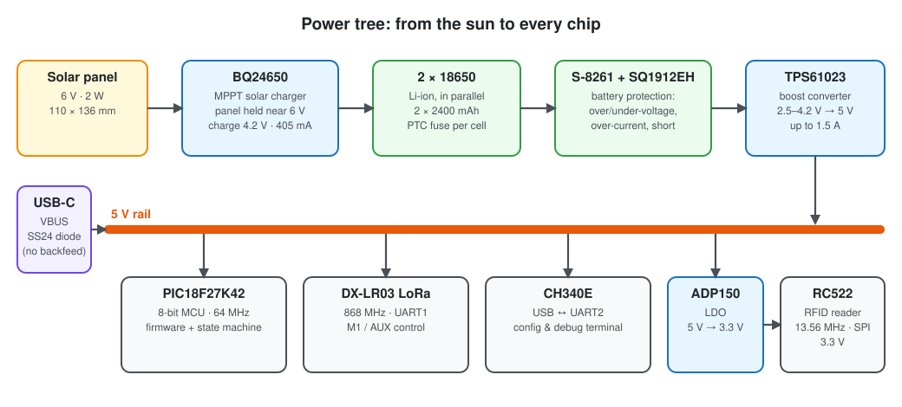
</p>

- **Solar charging:** the **BQ24650** charges the batteries from a **6 V / 2 W** panel. Its MPPSET input keeps the panel working near its **maximum power point** (set to 6 V). The charge voltage is set to **4.2 V** and the charge current to **405 mA**, within the cells' limits. Two LEDs on its STAT pins show *charging* and *charged*.
- **Batteries:** two **18650 Li-ion cells in parallel** (2 × 2400 mAh), each with its own **PTC fuse** as passive protection.
- **Active battery protection:** the **S-8261** watches voltage and current, and opens the dual MOSFET **SQ1912EH** on the negative side in case of overcharge, over-discharge, over-current or short-circuit. That is why the battery's negative (`GND_2`) and the system ground (`GND`) are separate nets, all the way to the copper planes.
- **5 V boost:** the **TPS61023** raises the battery voltage (2.5–4.2 V) to a steady **5 V**, up to 1.5 A, for the PIC, the LoRa module and the CH340E.
- **3.3 V LDO:** the **ADP150** turns 5 V into a clean **3.3 V** for the RC522 reader, which only draws about 30 mA at peak.
- **USB power:** the board can also run from the **USB-C** port. A **Schottky diode** lets VBUS feed the 5 V rail but stops the boost converter's 5 V from flowing back into the computer.

### Other subsystems

- **USB-serial interface:** a **CH340E** connects the PC to the PIC's second UART. The USB-C connector has the **5.1 kΩ pull-downs on CC1/CC2** required by the Type-C specification, so the computer recognizes the board as a device and supplies power.
- **Serial activity LEDs:** one transistor and LED per UART line (TX/RX), blinking when data flows.
- **User interface:** the **4 position LEDs** and the **DIP switch**.
- **Test points** on every important signal: `BAT+`, `GND_2`, `BQ_OUT`, `5V`, `3V3`, `GND`, `PWR_USB`, both UARTs (LoRa and PC) and the SPI bus (SDI, SDO, SCK, CS).
- **Charger jumper:** a 2-pin header between the charger output and the batteries. Removed, it lets you **measure the charge current** with an ammeter, or **isolate the charger** and run from the batteries alone.

### PCB design

<p align="center">
  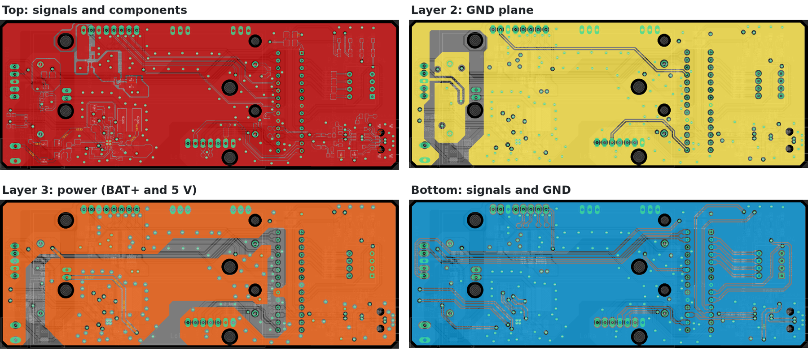<br>
  <em>The four copper layers of the board</em>
</p>

| Layer | Use |
|---|---|
| **Top** | All SMD components and most signals, with a GND pour and smaller 5 V, 3V3, `GND_2` and `BQ_OUT` areas |
| **Layer 2** | Continuous **GND plane**, with a separate island for the battery negative (`GND_2`) |
| **Layer 3** | **Power plane** split in two: `BAT+` around the charger and the boost converter, and **5 V** for the rest of the board |
| **Bottom** | Signals that didn't fit on top, plus a GND pour |

Design practices applied:

- **Manufacturing rules:** JLCPCB's 4-layer standard process parameters were loaded into Eagle's DRC before routing (through vias only, 0.35 mm minimum drill).
- **Power ICs laid out per their datasheets:** input and output capacitors right next to the pins, a **compact switching node** on both switching converters, **feedback traces** (BQ24650 `VFB`/`MPPSET`, TPS61023 `FB`) routed away from it, **wide traces** on the charge and boost paths, and **thermal vias** under the BQ24650.
- **USB differential pair** routed at controlled impedance: 0.3048 mm tracks with 0.25 mm spacing give **83.4 Ω**, inside the USB 2.0 target of 90 Ω ± 10 %. The impedance was calculated with the Saturn PCB Toolkit.
- **EMC:** continuous ground planes for short return paths, decoupling at every IC, and **rows of ground vias** along the SPI and UART lines, which act as a guard against coupling with nearby signals.

---

## Results

The system was tested on a line of **4 stops**, using the PCBs and four tags as buses.

| Test | Result |
|---|---|
| RFID write and read of the bus ID | **100 %** on 4 tags |
| LoRa addressing | Only the addressed stop receives the frame |
| Delivery along 4 stops (with ACK and retransmission) | **≈ 97 %** |
| PCB subsystems | Battery power, solar charging, USB power and USB serial all working |
| Consumption at 3.7 V | **156 mA** idle · **116 mA** between transmissions · **690 mA** peak while transmitting |
| Average consumption (15 buses per stop per day, worst case of 5 attempts per direction) | **≈ 157 mA**, because the system spends over 99 % of the time idle |
| Autonomy without sun (2 × 2400 mAh) | **≈ 30.6 hours** |
| Solar charge current | **255 mA** with a lab supply at 6 V, **220 mA** outdoors with a clear sky, both above the average consumption |

In short, the decentralized RFID + LoRa architecture works as a proof of concept: the bus is detected, only authorized buses are accepted, the last stop is recorded correctly at every stop, and a stop runs for more than a day without sun while the panel covers the consumption during the day.

---

## Known limitations and next steps

These are the open points of the current version, in order of priority:

1. **Battery over-current protection is disabled in this board revision.** The S-8261 trips when the voltage across the protection MOSFETs exceeds 100 mV. With the SQ1912EH's on-resistance (about 0.45 Ω for the pair), that happens at about **220 mA**, below the **350 mA** inrush of the TPS61023 at start-up, so the protection cut the power on every boot. As a workaround, the S-8261's VM pin is tied to VSS, which disables the over-current detection only. **Fix:** MOSFETs with an on-resistance below about **22 mΩ** each, so the full 2.25 A boost input current stays under the 100 mV threshold.
2. **The TX/RX activity LEDs are inverted.** NPN transistors were fitted where PNP ones were needed. The UART lines idle high, so the LEDs stay on and blink *off*. The fix is swapping the transistor type in the next revision.
3. **RFID range.** The RC522 with HF proximity tags was the right low-cost choice to prove the concept, but it reads one tag at a time at a few centimetres. A real installation needs **UHF RFID**, which reads at several metres and can see more than one bus at once.
4. **Field testing.** Long outdoor tests are still needed: temperature, humidity, interference, solar charging in poor light, and later formal EMC tests and an IP-rated enclosure.
5. **Lower power.** The LoRa module's sleep mode isn't used yet. A module that **integrates the LoRa radio and the microcontroller** would cut consumption considerably.
6. **Security.** LoRa frames are not encrypted, which is fine for a proof of concept but required for production.

---

## Tools

- **Firmware:** MPLAB X IDE, MPLAB XC8 compiler, MPLAB Code Configurator (MCC), PICkit 5
- **Hardware:** Autodesk Eagle (schematic and 4-layer layout), Saturn PCB Toolkit (impedance), JLCPCB (fabrication)
- **Testing:** CoolTerm serial terminal, multimeter and bench power supply

---

## Author

**Ivo Azevedo**: hardware design (schematic and PCB) and firmware.
